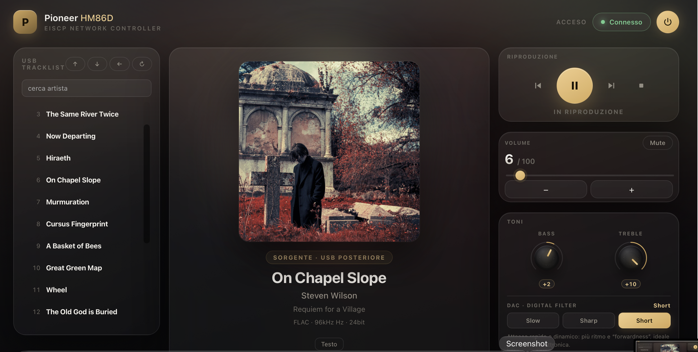

<div align="center">

# 🎛️ Pioneer HM86D Controller

**A modern web remote for the Pioneer X-HM86D micro system, built on the eISCP protocol.**

[](https://nodejs.org)
[](https://expressjs.com)
[](#-license)
[](#)
[](#)
[](https://github.com/supergino/pioneer_player)

> Control volume, sources, playback, tones, CD track info and USB/NET tracklists from any browser on your local network — no app install required.
>
> 🟡 **Beta Version** — the project is under active development: features and bug fixes are added regularly.

</div>

---

## ✨ Highlights

- 🎚️ **Volume, mute, bass & treble** with graphical knobs
- 📻 **Source selection** grouped by category (local, wired inputs, network, wireless)
- ▶️ **Transport controls** (play/pause/stop/next/prev) for USB, NET and the built-in CD player
- 💿 **CD player support** with animated disc, track counter and MusicBrainz tracklists
- 📋 **USB/NET tracklist browser** with folders, search and instant playback
- 🖼️ **Album art** in real time (with placeholder when unavailable)
- 🎤 **Lyrics lookup** for the current track (works for CD too, via MusicBrainz)
- 🔊 **DAC digital filter** selector (Slow / Sharp / Short)
- 🌙 **Sleep timer** and **dimmer** control
- 📡 **Server-Sent Events** for live state updates — no polling in the browser
- 🩺 **Built-in diagnostics** (TCP ping, gateway, launchd context)

---

## 📸 Screenshot



---

## 🏗️ Architecture

```
┌────────────┐   HTTP/SSE    ┌──────────────┐   TCP/eISCP    ┌─────────────────┐
│  Browser   │ ◄───────────► │  server.js   │ ◄────────────► │  Pioneer HM86D  │
│ (index.html)│               │  (Express)   │   port 60128   │  (receiver)     │
└────────────┘               └──────┬───────┘                └─────────────────┘
                                   │
                                   └── eiscp.js  (TCP client, state, polling)
```

| File | Role |
|---|---|
| `server.js` | Express server, REST API, SSE stream, device client orchestration |
| `eiscp.js` | eISCP TCP client, protocol parser, state machine, polling |
| `public/index.html` | Single-page UI (HTML + CSS + JS, no build step) |
| `launch.sh` / `stop.sh` | macOS/Linux service helpers |

---

## 🚀 Quick start

### Prerequisites
- Node.js (LTS)
- A Pioneer X-HM86D on the same LAN (default IP `192.168.100.6`)

### Run

```bash
git clone https://github.com/<your-user>/pioneer_player.git
cd pioneer
npm install

# Default
./launch.sh

# Or with a custom device IP
DEVICE_HOST=192.168.1.50 ./launch.sh

# Open in browser
open http://localhost:3000
```

Stop with `./stop.sh`.

### Environment variables

| Variable | Default | Description |
|---|---|---|
| `HTTP_PORT` | `3000` | Web server port |
| `DEVICE_HOST` | `192.168.100.6` | Receiver IP address |
| `DEVICE_PORT` | `60128` | eISCP TCP port |

---

## 🎛️ Features in detail

### Sources (grouped)
- **Local**: CD, USB front, USB rear, FM, DAB/DAB+
- **Inputs (wired)**: Optical, Line-in (RCA) — _this model has no coaxial input_
- **Network**: NET menu (Spotify, TIDAL, Deezer, Amazon Music, TuneIn, AirPlay, Chromecast built-in, FlareConnect, DTS Play-Fi, Music Server)
- **Wireless**: Bluetooth

> Network services are not separate `SLI` inputs on the HM86D — they are selected from the receiver's NET menu or launched from their apps.

### CD player
The HM86D does not report track number or playback time over eISCP. This app keeps a **virtual clock** based on MusicBrainz track durations and advances the counter automatically while playing; pause freezes it. Use the **± buttons** to realign if you skip tracks with the receiver's remote.

### Tracklist
- USB/NET lists load automatically at startup and on reconnect (watchdog every 4s until complete).
- Search filters by title and artist; the term persists across folders.
- CD tracklist comes from a selected MusicBrainz release.

---

## 🔌 API overview

| Endpoint | Method | Description |
|---|---|---|
| `/api/state` | GET | Current device state + `sourceGroups` catalog |
| `/api/events` | GET | SSE stream (`status`, `state`, `log`, `nla`) |
| `/api/command` | POST `{action, value}` | Generic commands (`power`, `volume`, `input`, `play`, `bass`, `treble`, `digitalFilter`, `sleep`, `dimmer`, `raw`) |
| `/api/list/*` | various | USB/NET list navigation (`refresh`, `select`, `back`, `up`, `down`, `snapshot`) |
| `/api/cd/*` | various | MusicBrainz lookup/search/release, track alignment, tracklist durations |
| `/api/lyrics` | GET | Lyrics proxy (multiple sources, first match) |
| `/api/art` | GET | Album art proxy (avoids CORS/mixed-content) |
| `/api/host` | POST | Change device IP/port |
| `/api/diag` | GET | Network diagnostics |
| `/api/wol` | POST | Wake-on-LAN |
| `/api/log` | GET | Last 100 log entries |

---

## 🖥️ Supported Devices

This controller is built for the **Pioneer X-HM86D**, but it can be used with other **Pioneer / Onkyo / Integra** receivers provided they meet the following requirements.

### Minimum requirements
- **eISCP / ISCP over TCP** on port `60128`
- Basic control commands: `PWR` (power), `MVL` (volume), `AMT` (mute), `SLI` (input selector)
- USB / NET tracklist browsing: `NTC LIST`, `NLA`, `NLS`, `NLT`
- File information: `NFI` (format, sample frequency, bit rate)
- Tone controls: `TFR` (bass / treble)
- DAC digital filter: `DGF` (Slow / Sharp / Short)
- Network playback status: `NST`, `NTI`, `NAT`, `NAL`, `NTR`, `NTM`
- Album art: `NJA`

### Optional (built-in CD player)
If the receiver has an integrated CD player, these commands enable CD support:
- `CST` (CD play status)
- `DST` (disc status / disc inserted)
- `CCD` (CD operations: `PLAY`, `STOP`, `PAUSE`, `SKIP.F`, `SKIP.R`)

> ⚠️ **Note:** input selector codes (`SLI`) vary by model. If your receiver uses different codes than the HM86D, you may need to update the input map in the code. Zone 2/3, tuner, listening mode (`LMD`), HDMI CEC and other model-specific features are not yet implemented.

## 🧩 Compatibility with other models

The transport layer (TCP + ISCP framing on port 60128) is shared by the whole **Onkyo / Pioneer / Integra** family, but **input codes and features differ per model**.

| Family | Compatibility | Notes |
|---|---|---|
| **Pioneer X-HM (micro systems)** | 🟢 High | HM76D, HM96D, etc. share almost identical command sets. Verify input codes and DAB/USB presence. |
| **Pioneer VSX / SC (AVR)** | 🟡 Medium | eISCP supported, but different input codes, HDMI inputs, Zone 2/3, listening modes (`LMD`), tuner. Remove CD-specific code. |
| **Onkyo TX-NR / Integra DTR** | 🟡 Medium | Same protocol, different input codes and DSP/Zone commands. Use `onkyo-eiscp` YAML DB as reference. |
| **Yamaha / Denon / Marantz** | 🔴 None | Different protocols (YNCA, Denon ASCII telnet). Requires rewriting the client. |

### To generalize
1. **Feature detection** via `IFN`/`FWV`/`DVC` responses (see `crowbarz/aiopioneer`).
2. **Per-model config files** (e.g. `models/hm86d.json`) with `SLI` codes and enabled features instead of hardcoded `INPUTS`.
3. **Modular UI** — conditionally render CD panel, Zone controls, tuner, etc.
4. An **eISCP simulator** (like `avrpi/lib/fake-device.js`) for testing without hardware.

> The `onkyo-eiscp` command database (YAML) and `aiopioneer` decoders are excellent references for extending support.

---

## 🛠️ Development

```bash
# Syntax checks
node --check eiscp.js
node --check server.js

# Run on a custom port
HTTP_PORT=3100 node server.js
```

### Conventions
- CommonJS, `'use strict'`, `const`/`let` (no `var`).
- Comments in English.
- `client.state` is the single source of truth for the device.
- `renderState(st)` must not contain early `return`s that skip knob/volume updates.

---

## 📁 Project layout

```
pioneer/
├── AGENTS.md          # Detailed dev instructions (LLM-friendly)
├── README.md          # This file
├── package.json
├── server.js          # Express + eISCP orchestration
├── eiscp.js           # TCP client & protocol parser
├── public/
│   └── index.html     # Single-page UI
├── docs/
│   ├── banner.png     # Hero image
│   └── screenshot.png # App screenshot
├── launch.sh
└── stop.sh
```

---

## 🤝 Contributing

Contributions are welcome — especially:
- Per-model input maps and feature flags
- Additional commands (listening mode, Zone 2/3, tuner, dimmer, sleep)
- An eISCP simulator for CI/testing
- Translations

Please read [`AGENTS.md`](AGENTS.md) before submitting changes — it documents the data flow and known pitfalls.

---

## 🙏 Acknowledgments

This project was developed by studying and referencing the following open-source projects that implement or document the eISCP / ISCP protocol for Pioneer, Onkyo and Integra receivers. They were used as reference for command codes, protocol framing and message parsing; no source code was copied verbatim from them.

| Project | Language | Role |
|---|---|---|
| [mkulesh/onpc](https://github.com/mkulesh/onpc) | Java / Android | Reference implementation for eISCP messages and list handling (`NLA`, `NLS`, `NLT`, `CCD`, `NFI`). |
| [miracle2k/onkyo-eiscp](https://github.com/miracle2k/onkyo-eiscp) | Python | Command database (YAML) with parameter values and descriptions. |
| [tillbaks/node-eiscp](https://github.com/tillbaks/node-eiscp) | JavaScript / Node | Node.js client and command reference (`eiscp-commands.json`). |
| [owagner/onkyo2mqtt](https://github.com/owagner/onkyo2mqtt) | Python | Example of eISCP → MQTT bridge and automatic reconnection. |
| [cljk/jEISCP](https://github.com/cljk/jEISCP) | Java | Remote JavaFX with raw ISCP console for debugging. |
| [crowbarz/aiopioneer](https://github.com/crowbarz/aiopioneer) | Python | Complete Pioneer API library with decoders and code map. |
| [crowbarz/ha-pioneer_async](https://github.com/crowbarz/ha-pioneer_async) | Python | Home Assistant integration based on `aiopioneer`. |
| [okeck1982/ioBroker.pioneer_sc_vsx](https://github.com/okeck1982/ioBroker.pioneer_sc_vsx) | JavaScript | ioBroker adapter mapping Pioneer properties to commands. |
| [domblb/avrpi](https://github.com/domblb/avrpi) | JavaScript / Node | Command catalog and eISCP simulator for testing. |
| [HerrRiebmann/eISCP-Interface](https://github.com/HerrRiebmann/eISCP-Interface) | C++ / ESP32 | Minimal reference for packet construction and parsing. |

---


## 📜 License

MIT — see [LICENSE](LICENSE).

---

<div align="center">

Made with ☕ for the Pioneer X-HM86D

</div>
